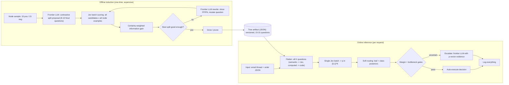

# Semantic Decision Tree (SDT) — Build Plan

**One-line summary:** Grow decision trees over unstructured data by inducing atomic yes/no questions with a frontier LLM offline, score all node questions in a single parallel Jev batch at inference (~150 ms regardless of depth), route softly over every leaf path, and optimize the routing layer on cached probabilities.

---

## 1. Problem and why this design

Adjudicating messy input (an email thread plus order/account JSON) with one big LLM prompt is slow, expensive, and biased by emotional language. A classic decision tree asks questions one at a time, so latency scales with depth. Flattening removes that cost structure: a depth-4 binary tree is 15 internal-node questions evaluated in one parallel pass, and path routing becomes local arithmetic measured in microseconds.

Hard splits (p > 0.5 goes left) are fragile because one borderline 0.51 judgment hijacks the rest of the path. Soft routing multiplies branch probabilities along every root-to-leaf path, so a 0.99 at the root automatically down-weights the wrong subtree to 0.01, while a 0.55 lets both subtrees contribute proportionally.

## 2. Success criteria (prototype gates)

For the refund-adjudication prototype on a frozen, family-held-out test split curated from tau2-bench retail (Section 6):

| Criterion | Target |
|---|---|
| Precision on auto-executed decisions | ≥ 97% |
| Automation coverage at that precision | ≥ 60% of test tickets |
| End-to-end latency (Jev batch + routing) | p95 ≤ 300 ms (model time ~150 ms) |
| Baseline delta | Beat single-prompt frontier classifier on the accuracy-vs-coverage curve at matched coverage |
| Cost | Auto-resolved ticket ≤ 1 Jev batch call; frontier LLM only during induction and escalations |

## 3. Architecture

Two loops, one artifact between them.



## 4. Core artifacts and nomenclature

- **Noul question** — an atomic, unambiguous yes/no question. Typed as:
  - `semantic` — needs Jev (e.g. "Does the user explicitly request a refund, replacement, or billing reversal?")
  - `computed` — answerable exactly from the JSON by code (e.g. "Was the order delivered within the past 30 calendar days?"). Computed questions return p in {0, 1} and never spend model capacity.
- **Tree artifact** — versioned JSON: nodes, edges, question refs, leaf-to-class mappings. The unit of deployment.
- **Score cache** — `(example_id, question_hash) -> p` in parquet. Rewording a question invalidates only its column; everything else is reused.
- **Calibration** — temperature scaling fitted on the validation split's cached p-vectors.

Schemas (pydantic): `Example`, `Question`, `Tree`, `ScoreVector`, `DecisionRecord`.

### Scorer backend decision (2026-11-13)

The concrete scorer engine is now Gemini Decision 1 via the Gemini Decisions
API (launched 2026-11-11): noul yes/no questions returning calibrated
probabilities in a single forward pass, up to 1,000 questions per request,
input billed once no matter how many questions ride along, 150-250 ms
end-to-end, 0.10 USD per 1M input tokens with zero output-token billing.
Jev stays as the interface name in code; GeminiDecisionClient
(sdt/gemini_decision_client.py) is the backend, with an injectable transport
so all client logic is testable offline. Computed questions never hit the
API. Live runs require a networked machine plus a Google AI Studio key
(paid tier recommended: the free tier trains on your data); GCP/Vertex
integration was announced as coming soon. The sandbox running this build has
neither network nor credentials, so live smoke runs happen outside it.

## 5. Roadmap

### Phase 0 — Foundations

- Repo layout below; Python 3.11+; pydantic schemas for all core artifacts.
- Dataset: curate the retail domain of tau2-bench as the labeled anchor set (pipeline in Section 6): reference-action ground truth joined with the order/account JSON from its database, emitted into our Example schema. Pin the tau2-bench commit; check its license before redistributing derived data.
- Augmentation to ~300 examples with label-preserving tone perturbations (emotional-but-ineligible, terse-but-eligible, distractor details). The seeded synthetic generator stays as a unit-test fixture and fallback.
- Splits: scenario-family-held-out test split, frozen before any tuning; fixed seeds throughout.
- Client wrappers: Jev (batching, retry, latency/cost logging) and frontier LLM (induction-only guard).
- PII scrubbing pass before any external call.

**Acceptance:** schemas validate; smoke run of one 15-question Jev batch returns a p-vector; data card + pinned tau2-bench manifest written.

**Implementation notes (2026-11-13):** Phase 0 landed stdlib-only (dataclasses + unittest) because the sandbox has no package index or network; the pydantic swap stays mechanical. policy.md and split_tasks.json were fetched completely via web reader (checksums in data/raw/tau2/manifest.json); tasks.json only partially (tasks 0-1 embedded verbatim as fixtures), so full curation awaits a real clone in third_party/. The live Jev smoke batch is likewise blocked on credentials; MockJevClient covers the offline path.

### Phase 1 — Baselines (freeze before touching induction)

- **B1** zero-shot single-prompt frontier classifier — the incumbent to beat.
- **B2** hand-written 15-question tree from the seed questions below, hard routing — early signal that decomposition helps at all.

**Acceptance:** baseline table (accuracy, macro-F1, latency, $/1k tickets) frozen on test.

**Implementation notes (2026-11-13):** B2 harness landed offline: hand tree (9 questions, 10 leaves) derived from policy.md, hard + soft runners, metrics (accuracy, macro-F1, confusion, coverage@precision sweep), report CLI. Runs use HeuristicJevClient, a deterministic keyword stand-in - reports are stamped as plumbing validation, not Jev quality. Early structural result already visible: the soft tree trades coverage for precision (33% at 100% precision on the synthetic corpus) while hard routing cannot abstain at all (no feasible point at 97% precision). The request_photo_proof family lands in auto_approve by design: it is out-of-taxonomy for tau2-derived questions. B1 is wired for MockFrontierClient and awaits the live endpoint.

### Phase 2 — Contrastive tree induction

1. **Propose:** at each node, sample 15 positive / 15 negative examples, then the frontier LLM proposes 8-10 Noul questions. A validator rejects questions containing label terms (leakage guard).
2. **Score:** all candidate questions across all node examples in one Jev pass, cache-aware.
3. **Select:** certainty-weighted gain:

```
Score(q) = IG(q) * mean_i( 2 * |p_i(q) - 0.5| )
```

   Standard information gain (entropy or Gini) penalized when Jev clusters at 0.50 and rewarded when probabilities push toward 0.0 / 1.0.
4. **Stop / grow:** max depth 4, min leaf size, purity threshold.
5. **Refine (LLEGO / TextGrad style):** when the best split still has high error, collect its false positives and false negatives, show them to the frontier LLM, and ask for rewritten questions that disambiguate the edge cases; rescore and keep the best.
6. **Prune:** collapse leaves sharing a majority class; drop rarely-triggered branches. Target: at most 15-31 questions total.

**Acceptance:** induced tree beats B2 on validation macro-F1; question count within budget; one-time induction cost logged in dollars.

**M2 result (2026-11-14, live):** induced tree 0.667 accuracy / 0.456 macro-F1 vs hand tree 0.175/0.193 and majority-class 0.298 - the M2 gate passes decisively. Rare classes (escalate, modify_user, politely_deny) score near zero because top-2 contrastive pairing never proposes for them; no 97%-precision operating point exists yet (peak 0.727 precision at 0.097 coverage), making calibration the next bottleneck. Full analysis: eval/reports/m2_analysis.json.

### Phase 3 — Soft routing and gating engine

- **Soft path multiplication:** every leaf k gets P(leaf_k) = product over edges e in path(k) of P(e), computed in **log space** (sum of log-probabilities, renormalized per class) to avoid numerical underflow at depth 4.
- **Class posterior:** sum leaf probabilities per class.
- **Margin gate:** auto-execute when P(c1) - P(c2) > 0.60.
- **Path bottleneck gate:** escalate when any node on the dominant path has 0.35 < p_i < 0.65 (out-of-distribution smell test).
- **Escalation handler:** frontier LLM receives the input plus the tree's evidence (p-vector, top leaf paths) as structured context.
- **Logging:** every decision records input hash, p-vector, leaf distribution, gate outcome, latency. This is the raw material for Phase 4 and distillation.

**Acceptance:** unit tests of the soft-routing math against hand-computed cases; gate thresholds swept on validation only.

### Phase 4 — Hybrid optimization on cached probabilities

1. **Freeze the tree**, run all K questions once over the training set, cache p in [0,1]^K. Jev is now a zero-shot semantic feature extractor.
2. **Train combiners on cached features** (CPU, seconds): regularized logistic regression (calibration baseline), shallow XGBoost, and a small differentiable soft-routing head (learned branch weights + temperature). Compare against pure soft-tree routing.
3. **Coordinate descent on prompts:** treat each question's wording as a discrete parameter. Find the node contributing most to validation cross-entropy, generate 5 rewordings, keep one that lowers loss; budget at most 2 rounds per node.

**Acceptance:** best combiner beats pure routing on validation macro-F1 and coverage@97%precision; ablation table (routing-only, +combiner, +prompt descent).

### Phase 5 — Evaluation and the coverage curve

- Sweep the confidence threshold on the **test** split; for each threshold compute precision and coverage of the auto-executed set. Headline number: **coverage@97% precision**.
- The anchor set is small; also report k-fold mean plus-minus sd over scenario families so the headline has honest error bars.
- Report: accuracy-vs-coverage curves (SDT vs B1 vs B2), macro-F1, confusion matrix at the operating point, latency p50/p95, escalation rate, cost per 1k tickets.
- Error taxonomy: gate that fired, most-uncertain node, leaf confusion pairs.

**Acceptance:** final report; go/no-go decision for Phase 6.

### Phase 6 — Stretch: semantic forest and distillation

- **Forest:** induce 3-4 depth-3 trees from different prompt perspectives / bootstrap subsets (21-28 questions, still one Jev batch); average class distributions.
- **Distillation:** once production logging accumulates 5k-10k (input, questions, calibrated p) tuples, fine-tune ModernBERT or Qwen-1.5B with K sigmoid heads to mimic the batch outputs, giving sub-10 ms local inference with zero per-request API cost. Keep the Jev path as fallback and monitor agreement.

## 6. Benchmark: curating tau2-bench retail

tau2-bench ships reviewed customer-service tasks graded against deterministic database outcomes (refund issued or denied), so ground-truth action labels come for free, with no LLM judge in the label loop. The retail domain provides exactly the artifacts we need:

- tasks.json — task scenarios with the simulated user instructions/persona, plus an evaluation_criteria block whose actions field holds the reference trajectory (the tool calls that derive the target DB end state).
- db.json — the domain database (users, orders, products, refunds) to join per-task order/account context.
- policy.md — the retail adjudication policy: source of truth for seeding computed questions and for validating our decision labels.
- split_tasks.json — upstream task splits; reuse rather than re-split blindly.

Curation pipeline (sdt/data/tau2_curate.py):

1. Pin a tau2-bench release; record the commit hash in a data manifest.
2. Parse retail tasks; for each, extract the user instructions, the referenced user_id, and the reference trajectory from evaluation_criteria.actions.
3. Filter to adjudicable tasks: the trajectory must terminate in a decision we can map (a refund/return/exchange write, or a policy-mandated denial with no write). Pure lookup or ID-verification tasks are dropped or marked out-of-scope.
4. Derive the label from the terminal DB writes of the reference trajectory, never from model output: refund executed leads to Auto-Approve; no write plus policy denial leads to Politely Deny; trajectory requires soliciting evidence/confirmation first leads to Request Photo Proof; chargeback/legal mentions lead to Escalate to Legal/Fraud. This mapping is derived from policy.md and hand-audited on ~20 tasks before scaling; expect to adjust the taxonomy to the actual action space (e.g. an Exchange class) rather than force-fit the four classes.
5. Join db.json on user_id; render the order/account slice as the semi-structured context, precomputing the fields behind computed questions (delivery window, refund count).
6. Render the unstructured side in two variants per task: a verbatim rendering of the user instructions, and an LLM-paraphrased emotional variant that must preserve every factual field (label-preserving perturbation, spot-checked by hand).
7. Emit Example records; write a data card with per-class counts and scenario-family assignments.

Caveats handled explicitly:

- tau2-bench user instructions describe what the caller wants; they are not literal email threads. The rendering step converts them, and both variants ship side by side so tone robustness is measurable.
- Multi-turn dependencies (agent must elicit missing info across turns) do not flatten to a single pass; label them needs-info and either treat them as escalate ground truth or exclude from the v1 single-pass prototype.
- Official tau2-bench agent scores are not comparable to ours (they evaluate full agentic loops); we reuse the data, not the leaderboard numbers.
- Refund-executed tasks likely dominate; measure class balance in the data card and rebalance minority classes via label-preserving augmentation.

## 7. Prototype use case — support refund and policy adjudication

- **Input:** unstructured customer email thread + semi-structured order/account JSON.
- **Classes:** Auto-Approve / Request Photo Proof / Escalate to Legal/Fraud / Politely Deny.
- **Why it fits:** emotional loyalty language ("loyal customer for years, unacceptable!") biases single-prompt models into policy violations; atomic objective questions isolate the facts.
- **Seed questions** (Q2 and Q5 are `computed`):
  1. Root: Does the user explicitly request a refund, replacement, or billing reversal?
  2. Was the order delivered within the past 30 calendar days per the account JSON?
  3. Does the user state or imply the item arrived damaged, defective, or incomplete?
  4. Does the customer mention a chargeback, legal action, or regulatory complaint?
  5. Has this account received more than two refunds in the past 90 days?

## 8. Risks and mitigations

| Risk | Mitigation |
|---|---|
| Jev probability calibration drift | Temperature scaling fitted on validation; recalibration job; monitor gate-trigger rates |
| Induced questions overfit training wording | Refinement selects on validation; keep K small; human readability review of final question set |
| Label leakage into question text | Schema validator rejects label-derived terms before scoring |
| Leaf probabilities underflow at depth | Log-space accumulation + per-class renormalization; depth capped at 4 |
| Induction cost blowup | Score cache keyed by question hash; frontier calls budgeted per node |
| Distribution shift (new product lines, policy changes) | Bottleneck gate as OOD tripwire leading to escalation; retrain combiner on fresh cached features (cheap); re-induce tree only when drift persists |
| Augmented variants too easy | Adversarial perturbation families; hold out entire scenario families, not random rows |
| Rendering drift: tau2 instructions are not emails | Ship verbatim + paraphrase variants side by side; hand-audit paraphrases for factual drift |
| Label-mapping ambiguity between tau2 actions and our classes | Hand-audit ~20 tasks; adjust taxonomy to actual action space; document mapping in data card |
| Benchmark version churn (v1 vs v2 task replacements) | Pin commit hash; freeze the derived dataset in-repo |

## 9. Proposed repo layout

```
semantic-decision-tree/
├── PLAN.md
├── sdt/
│   ├── schemas.py            # Example, Question, Tree, ScoreVector, DecisionRecord
│   ├── jev_client.py         # batched scoring wrapper (retry, cost/latency logs)
│   ├── llm_client.py         # frontier wrapper, induction-only guard
│   ├── induction/
│   │   ├── propose.py        # contrastive split generation + leakage validator
│   │   ├── gain.py           # certainty-weighted information gain
│   │   ├── refine.py         # FP/FN-driven question rewrites
│   │   └── prune.py          # collapse same-class leaves, drop rare branches
│   ├── routing/
│   │   ├── soft_tree.py      # log-space leaf distribution, class posterior
│   │   ├── gates.py          # margin + path bottleneck
│   │   └── escalate.py       # frontier escalation with p-vector evidence
│   ├── training/
│   │   ├── cache.py          # (example_id, question_hash) -> p
│   │   ├── combiners.py      # LR / XGBoost / differentiable soft-routing head
│   │   └── coordinate.py     # prompt coordinate descent
│   ├── eval/
│   │   ├── coverage.py       # accuracy-vs-coverage sweep, coverage@precision
│   │   └── report.py         # curves, confusion matrices, error taxonomy
│   └── data/
│       ├── tau2_curate.py    # extract tau2-bench retail -> Example records
│       ├── augment.py        # label-preserving tone/distractor perturbations
│       ├── synth_tickets.py  # seeded fixture generator for unit tests
│       └── loader.py
├── artifacts/trees/          # versioned tree JSON
├── cache/scores.parquet
├── eval/reports/
└── tests/                    # soft-routing math, gain scoring, gates, leakage validator
```

## 10. Milestones and decision points

| Milestone | Scope | Decision at the gate |
|---|---|---|
| **M1** | Phases 0-1: schemas, tau2 curation + augmentation, baselines frozen | Does decomposition (B2) show any signal over B1? If not, revisit question seeds before induction. |
| **M2** | Phase 2: induced tree beats hand tree on validation | Is automatic induction worth its cost vs the hand tree? |
| **M3** | Phases 3-4: soft routing + gates + best combiner | Does validation coverage@97% precision clear 60%? |
| **M4** | Phase 5: frozen-holdout report | Go/no-go on forest + distillation. |

## 11. Explicit assumptions

- Jev exposes a batched scoring endpoint taking multiple typed questions against one context in a single call, returning per-question probabilities in ~150 ms.
- Frontier LLM access is available for offline induction and escalation paths.
- tau2-bench retail provides the labeled anchor data; its grading is deterministic against DB end states, and we reuse reference actions (not leaderboard scores) as ground truth. License is verified at adoption before redistributing derived data.
- The synthetic generator is a unit-test fixture and fallback, not the primary corpus; historical tickets can still swap in later without schema changes.
