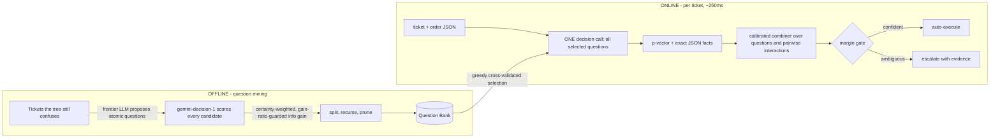

# Semantic Decision Tree

**Decision trees for unstructured data, built on Google's decision model - a frontier LLM mines the questions offline, one ~250ms batch answers them online, a calibrated gate decides: auto-execute or escalate. Zero fine-tuning.**

Decision models (gemini-decision-1) are fast, cheap, and literal. Hand them a messy support ticket plus an order JSON and ask whether this refund should be approved - they struggle, because the right answer turns on facts buried in the text and the fields, and one big question leaves no room for calibrated decomposition. Asking good atomic questions by hand does not scale.

This repo is a complete, reproducible research pipeline answering: **what if a decision tree's job is not routing at runtime, but mining questions offline?**

---

## The idea

Classic decision trees split on thresholds; this one splits on *questions an LLM invents*. The expensive reasoning (which questions matter?) happens once, offline. Inference is a flat batch:



The tree logic survives without the latency: branch-AND-conditions become pairwise probability products fed to a regularized linear layer (the RuleFit pattern), and uncertainty is preserved as calibrated confidence for the gate.

## Results

All numbers out-of-fold unless marked; every one reproducible from this repo **without an API key** (score caches are committed).

**The incumbent ladder** - each rung isolates one ingredient:

| System | Retail (n=114) | Telecom (n=2,285) |
|---|---|---|
| One-shot LLM question generation (it wrote 1 catch-all question) | 0.315 macro-F1 | - |
| Single-prompt classifier, few-shot | 0.543 | - |
| Single-prompt classifier, zero-shot | 0.557 | 0.023 |
| **This pipeline** | **0.645 / 69.3%** (holdout: **0.756 / 77.5%**) | **0.276 / 82.1%** |
| This pipeline, accuracy-tuned class weights | 0.649 / 71.1% | 0.250 / **87.1%** |

**Where each system fails** (retail per-class recall - the interesting part):

| Class | Single prompt | Pipeline |
|---|---|---|
| exchange (easy) | 25/26 | 23/26 |
| **auto_approve** (refund grants) | **4/27** | **19/27** |
| modify_order | **27/34** | 18/34 |
| escalate | 2/4 | 3/4 |

The single prompt wins the mid-frequency classes; the pipeline wins exactly the policy-sensitive ones. On telecom the zero-shot prompt answered one plausible-sounding action (refuel_data) for 96% of tickets at self-rated confidence 95 - the correct label lives in context fields, and the induced questions learned to probe them.

**Safe automation** (the deployment metric):

| Domain | Auto-executed | Precision | Latency | Remainder |
|---|---|---|---|---|
| Retail | 23.7% | 100% | ~250ms | escalated |
| Telecom | 75.6% | 99.1% | ~250ms | escalated |

**Cost:** the whole 18-iteration research program - three domains, all baselines and ablations - cost **under 2 dollars** of API spend.

## How it works

**Offline mining.** At each node, a frontier LLM sees tickets the tree still confuses (grouped by class) and proposes questions in three formats - noul (yes/no), choice (pick from options), score (ordered rubric). Every candidate is scored by gemini-decision-1 across the node's examples. Splits win by class-weighted information gain with certainty discounting, guarded by gain ratio (both C4.5 lopsided-split protections: a max(H_split, 0.35) denominator floor and a minimum minority effective-mass floor). Growth uses fractional routing - a p=0.7 ticket carries 0.7 mass down yes and 0.3 down no, matching soft inference semantics - then structural pruning. Semantic dedup (token-Jaccard over 0.75) stops branches from re-copying earlier questions, and a one-vs-rest pass guarantees minority classes dedicated proposals.

**The question bank.** Every question any run ever picked is banked with provenance. Single trees are lottery draws (measured: the same pipeline scored 0.40-0.66 macro-F1 across runs at n=114); the bank compounds - a mediocre run (0.51 on its own) contributed the question that later swung selection from 0.574 to 0.645. Final batches come from greedy forward selection over the whole bank by cross-validated macro-F1.

**Online.** One decision-model call scores all 6-10 semantic questions; four computed resolvers answer exact facts (order status, refund count, gift card) straight from the JSON - free, perfectly calibrated, zero tokens. A temperature-calibrated softmax over the question probabilities and their pairwise products produces the class posterior; a margin gate auto-executes confident decisions and escalates the rest with the p-vector as evidence.

## Key findings

1. **Iteration is the value.** One-shot generation (0.315) lands below even direct prompting (0.557): asked for a whole question set in one pass, the LLM writes one elegant catch-all question. The contrastive per-node loop - questions proposed for the tickets that remain confused - is what makes decomposition happen.
2. **Trees are for feature discovery; the combiner is the decision surface.** Deep trees starve at small n (measured: nested-CV macro-F1 0.315 vs 0.645 for flat selection). The flat combiner effectively is the depth, learning interactions without fragmenting examples.
3. **Choice questions are efficient features** - two questions once carried 87% of the champion's macro-F1 - and given a free format menu, LLMs pick a choice question for the root.
4. **Noul criteria (true/false descriptions) are a per-question instrument**, not a global one: wholesale application lowered macro-F1; one rare-class proxy gained. Adoption is decided per question by cross-validation.
5. **Calibration is the difference between a score and a dial.** Temperature-scaled decision-model probabilities yield real coverage-at-precision control; the single prompt's self-rated confidence-95 on systematically wrong answers yields none.

## Quickstart

Reproduce every published number offline - caches, corpora, and models are committed, no API key needed:

```bash
python3.11 -m unittest discover -s tests          # 113 tests
python3.11 -m sdt.training.run_selected \
    --corpus data/curated/tau2_retail/examples.jsonl \
    --cache cache/scores.json \
    --bank artifacts/question_bank.json \
    --state artifacts/bank_selection_v2.json \
    --out /tmp/champion.json
```

Run the full live pipeline (frontier + decision-model calls, pennies per stage):

```bash
cp .env.example .env        # add GEMINI_API_KEY
# one-time: clone tau2-bench per third_party/README.md
bash scripts/run_live_pipeline.sh
```

## Repo map

| Path | What it is |
|---|---|
| sdt/ | the pipeline: induction, routing, combiners, experiments, baselines |
| tests/ | 113 unit tests (stdlib only) |
| ITERATIONS.md | the full research log - 18 iterations, pre-registered expectations, failures included |
| eval/reports/ | every result artifact + benchmark_sheet.md (paste-ready tables) |
| cache/ | committed decision-model scores (keyless reproduction) |
| artifacts/ | question banks, trees, trained champion models |
| data/curated/ | tau2-bench-derived corpora (deterministic; audit CSVs included) |

## Methodology notes (the receipts)

- Baselines ran under a fixed, symmetric harness: same inputs, same label taxonomy, temperature 0. A harness bug that undercounted the baseline (thinking-model output truncation) was caught via cached-raw-response audit, disclosed, and re-run before publishing - see ITERATIONS.md.
- The retail champion was additionally confirmed on tau2-bench's untouched 40-ticket holdout: 77.5% / 0.756 (question selection had seen those tickets' CV, which is disclosed).
- Combiner weights are always out-of-fold; question selection uses the full corpus. The coverage head is the CV estimate - on the small holdout it ran lower; treat it accordingly.

## Limitations

n=114 (retail/airline) is small-sample; rare classes at 4-6 examples cap what any method can prove there. Telecom-full's tail classes (1-4 examples) remain unreachable under any weighting. The hand-written baseline was agent-authored from the policy without iterative refinement - a fair label, not a human-expert benchmark. One benchmark family (tau2-bench) tested.

## License & attribution

MIT (see LICENSE). Benchmark tasks from sierra-research/tau2-bench (MIT). Decisions API behaviors verified against the 2026-11-11 launch.
